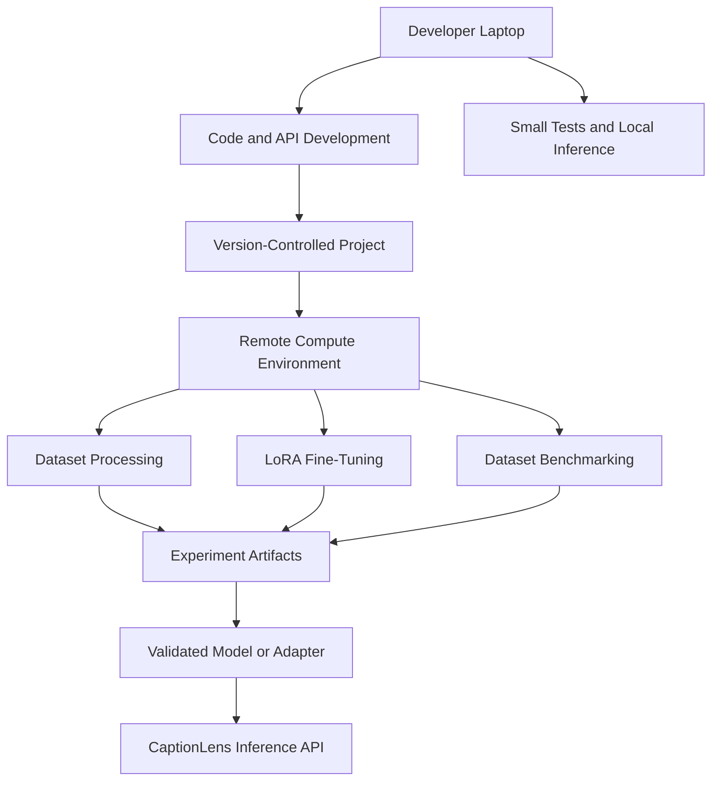

# CaptionLens
### Evidence-Aware Image Captioning and Hallucination Evaluation

> *Every caption makes a claim. CaptionLens helps investigate the evidence.*

"Can we trust what an image captioning model says about an image?"

Modern vision-language models can generate fluent, detailed descriptions of visual scenes. However, autoregressive text generation driven by statistical co-occurrence priors frequently produces **object hallucinations**—asserting the presence of objects, attributes, or spatial relationships that are entirely absent from the underlying visual pixels. 

**CaptionLens** is a modular research platform and evaluation toolkit designed to investigate factual reliability in image captioning. It combines conditional text generation (Salesforce BLIP-Base), object evidence extraction (TorchVision Faster R-CNN), COCO-normalized CHAIR object hallucination evaluation, standard n-gram metrics (BLEU-4, ROUGE-L), dataset manifest validation, FastAPI backend persistence, and an interactive research dashboard.

The project follows a **cloud-first, resource-efficient approach**: develop locally, use remote compute for demanding workloads, and expand model capabilities through measurable, reproducible experiments.

---

## Table of Contents

1. [Project Overview](#project-overview)
2. [Features and Implementation Status](#features-and-implementation-status)
3. [System Architecture](#system-architecture)
4. [Technology Stack](#technology-stack)
5. [Repository Structure](#repository-structure)
6. [Prerequisites and Installation](#prerequisites-and-installation)
7. [Using CaptionLens](#using-captionlens)
8. [API Documentation](#api-documentation)
9. [Research and Evaluation Methodology](#research-and-evaluation-methodology)
10. [Datasets](#datasets)
11. [Cloud-First Training and Resource Management](#cloud-first-training-and-resource-management)
12. [Fine-Tuning Pipeline](#fine-tuning-pipeline)
13. [Testing and Reproducibility](#testing-and-reproducibility)
14. [Limitations and Responsible Use](#limitations-and-responsible-use)
15. [Roadmap](#roadmap)
16. [References and Acknowledgements](#references-and-acknowledgements)
17. [License and Contributions](#license-and-contributions)

---

## 1. Project Overview

CaptionLens is structured as an end-to-end workflow for analyzing image descriptions:

1. **Image Ingestion:** A user provides an image through the API or frontend interface.
2. **Caption Generation:** The Salesforce BLIP-Base model generates a conditional natural language caption.
3. **Object Evidence Detection:** A TorchVision Faster R-CNN detector identifies object candidates, bounding boxes, and confidence scores.
4. **Hallucination Evaluation:** The CHAIR evaluation module parses the generated caption, normalizes and extracts object tokens, and compares them against optional ground-truth annotations.
5. **Reference-Based Evaluation:** BLEU-4 and ROUGE-L measure textual similarity against reference captions.
6. **Dataset Validation:** Dataset manifests are checked for missing images, malformed records, and missing annotations.
7. **Persistence and Logging:** Inference results, latency, model information, and evaluation statuses are recorded in an SQLite database (`captionlens.db`).
8. **Visualization:** The browser-based dashboard (`index.html`) visualizes the outputs, bounding boxes, evaluation results, and experiment logs.

### Scientific Distinction & Detector Limitations
An object detector's predictions do **not** constitute definitive ground truth. Faster R-CNN is constrained by its 80-class COCO vocabulary, can produce false positives or missed detections, and cannot verify subtle attributes, actions, or relational claims (e.g., color, count, spatial layout) solely through bounding boxes. CaptionLens treats object detections as auxiliary visual evidence rather than a complete verification oracle.

---

## 2. Features and Implementation Status

| Feature | Implementation File | What It Does | Status |
| :--- | :--- | :--- | :--- |
| **BLIP Caption Generation** | `model_pipeline.py` | Loads Salesforce BLIP-Base for conditional text generation with deterministic vs. exploratory decoding. | Implemented & Tested |
| **Object Evidence Detection** | `model_pipeline.py` | Runs TorchVision Faster R-CNN (ResNet-50 FPN) to extract object bounding boxes and labels. | Implemented & Tested |
| **Normalized CHAIR Evaluator** | `evaluate.py` | Computes sentence-level ($CHAIR_s$) and instance-level ($CHAIR_i$) hallucination scores with synonym and compound handling. | Implemented & Tested |
| **BLEU-4 & ROUGE-L Metrics** | `caption_metrics.py` | Computes reference-based n-gram overlap scores via NLTK and rouge-score with dependency fallbacks. | Implemented & Tested |
| **Dataset Manifest Validation** | `dataset_evaluation.py` | Validates JSON/JSONL dataset splits (DOCCI and COCONut manifest schemas). | Implemented & Tested |
| **FastAPI Backend** | `app.py` | Exposes REST endpoints for health checks, caption generation, evaluation, and log retrieval. | Implemented & Tested |
| **SQLite Persistence** | `database.py` | Initializes schema and records structured inference and evaluation logs in `captionlens.db`. | Implemented & Tested |
| **Interactive Dashboard** | `index.html` | Single-page frontend featuring live testing studio, literature survey, dataset analytics, and presentation deck. | Implemented & Tested |
| **LoRA Fine-Tuning** | `fine_tune_lora.py` | PEFT LoRA adapter training configuration script for vision-language models. | Experimental / Scaffolded |
| **Automated Tests** | `tests/test_api.py` | Pytest suite validating API endpoints, CHAIR logic, and database logging. | Implemented & Tested |
| **Docker Deployment** | `Dockerfile`, `docker-compose.yml` | Container build definitions and service orchestration configuration. | Implemented |

---

## 3. System Architecture

The following Mermaid diagram outlines the verified data flow for interactive inference, evaluation, and logging:

```mermaid
graph TD
    A[Image Upload] --> B[FastAPI Backend]
    B --> C[BLIP Caption Generator]
    B --> D[Faster R-CNN Object Detector]
    C --> E[Generated Caption]
    D --> F[Object Labels and Bounding Boxes]
    E --> G[Evaluation Engine]
    F --> H[Auxiliary Visual Evidence]
    I[Ground-Truth Annotations] --> G
    J[Reference Captions] --> K[Caption Metrics]
    E --> K
    G --> L[Evaluation Results]
    K --> L
    L --> M[SQLite Experiment Logs]
    M --> N[Research Dashboard]

## 4. Technology Stack

- **Programming Language:** Python 3.10+
- **Deep Learning:** PyTorch and TorchVision
- **Vision-Language Model:** Hugging Face Transformers and BLIP
- **Object Detection:** Faster R-CNN with ResNet-50 FPN
- **Backend:** FastAPI, Uvicorn, Pydantic
- **Evaluation:** NLTK, `rouge-score`, custom CHAIR-inspired evaluation logic
- **Database:** SQLite
- **Frontend:** HTML, Tailwind CSS, JavaScript
- **Testing:** Pytest and FastAPI TestClient
- **Deployment:** Docker and Docker Compose
- **Fine-Tuning:** PEFT and LoRA, where supported
- **Remote Compute:** Compatible cloud GPU or notebook infrastructure

---

## 5. Repository Structure

```text
image-captioning-research/
├── app.py
├── model_pipeline.py
├── evaluate.py
├── dataset_evaluation.py
├── caption_metrics.py
├── fine_tune_lora.py
├── database.py
├── index.html
├── Dockerfile
├── docker-compose.yml
├── requirements.txt
├── README.md
└── tests/
    └── test_api.py
```

Actual repository contents may differ as development progresses.

---

## 6. Prerequisites and Installation

### Prerequisites

- Python 3.10 or higher
- pip
- Git
- Internet access for downloading model weights when required
- Optional compatible NVIDIA GPU for accelerated inference or training

CPU execution may be possible, although model loading and inference can be slower.

### Clone the Repository

```bash
git clone https://github.com/YOUR_USERNAME/image-captioning-research.git
cd image-captioning-research
```

Replace `YOUR_USERNAME` with the correct GitHub username and repository URL.

### Create a Virtual Environment

**macOS / Linux**

```bash
python -m venv .venv
source .venv/bin/activate
```

**Windows**

```powershell
python -m venv .venv
.venv\Scripts\activate
```

### Install Dependencies

```bash
python -m pip install --upgrade pip
pip install -r requirements.txt
```

### Run Tests

```bash
python -m pytest -v
```

### Start the Backend

```bash
uvicorn app:app --reload --port 8000
```

Open the API documentation at:

```text
http://127.0.0.1:8000/docs
```

Open `index.html` in a browser to access the frontend, provided its API URL and browser access configuration are compatible with the running backend.

### Optional Docker Setup

```bash
docker compose up --build
```

Docker deployment should be tested to confirm that all required Python modules and model dependencies are included.

---

## 7. Using CaptionLens

A typical workflow is:

1. Start the FastAPI backend.
2. Open the frontend.
3. Upload an image.
4. Generate a caption.
5. Inspect the detected objects and bounding boxes.
6. Provide ground-truth object annotations when evaluating object hallucinations.
7. Provide reference captions when computing reference-based metrics.
8. Review the evaluation results and experiment logs.

A generated caption alone is not sufficient to establish whether its claims are factually correct. Evaluation requires appropriate annotations or references, depending on the metric.

---

## 8. API Documentation

The following endpoints describe the intended API interface. Confirm request schemas and response formats against the current implementation.

### Health Check

```http
GET /health
```

Checks whether the backend is running and may report the active compute device.

### Caption Generation

```http
POST /caption
```

Accepts an image upload and returns a generated caption and object detection results.

Example response:

```json
{
  "caption": "A person standing beside a bicycle.",
  "word_count": 6,
  "latency_ms": 142.5,
  "grounding_boxes": [
    {
      "label": "person",
      "confidence": 0.95,
      "x": 30,
      "y": 120,
      "w": 100,
      "h": 140
    }
  ]
}
```

The values above are illustrative, not measured results.

### Caption Hallucination Evaluation

```http
POST /evaluate
```

Example request:

```json
{
  "caption": "A person eating a hot dog next to a bicycle.",
  "ground_truth_objects": [
    "person",
    "hot dog",
    "bicycle"
  ]
}
```

The evaluator compares the caption's extracted object mentions with the provided annotations.

An evaluation should be marked `not_evaluated` when required ground-truth annotations are absent. Missing annotations must not be interpreted as a zero hallucination score.

### Retrieve Experiment Logs

```http
GET /logs
```

Returns available inference and evaluation records, subject to the implementation's query parameters and response schema.

---

## 9. Research and Evaluation Methodology

CaptionLens investigates caption reliability using complementary evaluation methods.

### A. CHAIR-Inspired Object Hallucination Evaluation

The CHAIR-inspired evaluator extracts object mentions from captions, normalizes supported synonyms and compound terms, and compares them with ground-truth object annotations.

- **CHAIR-s:** Sentence-level hallucination rate — the proportion of evaluated captions containing at least one unsupported object mention.
- **CHAIR-i:** Instance-level hallucination rate — the proportion of evaluated object mentions that are unsupported.

These definitions describe the intended scoring approach. Exact compatibility with the original CHAIR implementation requires validation against the original methodology and reference implementation.

### B. BLEU-4 and ROUGE-L

These reference-based metrics measure textual similarity between generated captions and human reference captions.

They do not directly prove factual correctness. A caption may achieve good textual similarity while still describing an object that is absent from the image.

### C. Object Evidence

Faster R-CNN supplies candidate object labels, bounding boxes, and confidence scores. Its predictions can help inspect visual evidence, but detector outputs must not automatically be treated as ground-truth annotations.

### D. Evaluation Requirements

Reliable evaluation requires:

- Clearly defined dataset splits.
- Valid image-to-annotation mappings.
- Consistent object normalization.
- Correct handling of missing annotations.
- Reproducible model and decoding configurations.
- Reporting of dataset size and evaluation coverage.
- Separate reporting of unsupported object mentions and other forms of factual error.

---

## 10. Datasets

CaptionLens can be extended to evaluate publicly available image-captioning and image-description datasets.

Potential datasets include:

- **MS COCO:** Commonly used for object detection and image captioning research.
- **DOCCI:** A dataset of detailed image descriptions designed for evaluating contextual image understanding.
- **COCONut-PanCap:** A panoptic captioning dataset.
- **ShareGPT4V:** A dataset containing image-text instruction and description examples.

Each dataset has its own annotation format, license, access conditions, and intended use. Integration requires an appropriate loader and validation against the actual dataset schema.

### Dataset Management Principles

- Begin with a small representative subset.
- Validate manifests before running expensive experiments.
- Check that every referenced image exists.
- Verify annotation completeness and image identifiers.
- Keep training, validation, and test splits separate.
- Do not use the evaluation test set to tune the model.
- Record dataset versions and preprocessing steps.
- Avoid automatically downloading every dataset during application startup.

Dataset manifest validation does not, by itself, establish that the dataset has been fully evaluated.

---

## 11. Cloud-First Training and Resource Management

CaptionLens follows a cloud-first approach for computationally demanding experiments. The objective is to improve model capabilities without requiring the developer's laptop to handle every training job.

### 11.1 Guiding Principle

**Develop locally, compute remotely, evaluate scientifically, and scale only when necessary.**

Training large vision-language models from scratch is not the default strategy. CaptionLens should first make effective use of pretrained models and determine where their limitations actually lie.

### 11.2 Local vs. Cloud Workloads

| Workload | Preferred Environment |
|---|---|
| Coding and debugging | Local machine |
| FastAPI and frontend development | Local machine |
| Unit tests and API checks | Local machine |
| Small inference experiments | Local machine, when feasible |
| Large-scale dataset evaluation | Cloud or remote compute |
| Dataset preprocessing at scale | Cloud or remote compute |
| LoRA fine-tuning | Cloud GPU |
| Full model training | Cloud GPU infrastructure, only when justified |
| Long-term checkpoint storage | Persistent or cloud storage |

This is a preferred allocation, not a strict requirement. Small workloads should remain local when practical.

### 11.3 Potential Compute Platforms

CaptionLens may use:

- **Google Colab:** For notebook-based experiments and compatible GPU workloads.
- **Kaggle Notebooks:** For supported notebook experiments and accessible datasets.
- **Cloud GPU providers:** For longer-running or more resource-intensive workloads.
- **Cloud and object storage:** For datasets, checkpoints, adapters, logs, and experiment artifacts.

These services are options rather than existing integrations. Their current availability, hardware, quotas, session limits, pricing, and storage restrictions must be checked before use.

### 11.4 Gradually Expanding Recognition

The number of objects a model can recognize should increase through targeted capability development, not simply by training for more epochs.

The planned process is:

1. Establish a baseline using the existing pretrained models.
2. Evaluate performance on a suitable dataset.
3. Identify missing object categories or recurring caption errors.
4. Select additional annotated data or a more suitable pretrained model.
5. Apply targeted fine-tuning or replace a component when justified.
6. Evaluate the updated system on held-out data.
7. Compare its results against the original baseline.
8. Keep the change only when it provides measurable benefits.

Expanding the detector's object vocabulary, improving caption generation, and reducing hallucinations are separate objectives. Improving one does not guarantee improvements in the others.

### 11.5 Efficient Fine-Tuning

Where supported, CaptionLens should prefer parameter-efficient approaches such as LoRA over full-model fine-tuning when they are suitable for the task.

LoRA can reduce the number of trainable parameters and the size of training updates. It does not eliminate the need for sufficient GPU memory, suitable training data, or evaluation.

The intended workflow is:

1. Load a documented pretrained checkpoint.
2. Validate the training dataset.
3. Record baseline results.
4. Configure the fine-tuning experiment.
5. Run the experiment on suitable remote hardware.
6. Save the adapter, configuration, and training metadata.
7. Evaluate on held-out data.
8. Compare the updated model with the baseline.
9. Deploy only a validated and compatible checkpoint or adapter.

Training should not be considered successful solely because a script finishes without errors.

### 11.6 Dataset and Storage Efficiency

Large datasets can consume substantial disk space, memory, and network bandwidth.

CaptionLens should:

- Use small subsets during initial development.
- Store dataset manifests separately from image data when practical.
- Download only the data needed for the current experiment.
- Store large datasets and checkpoints in appropriate persistent storage.
- Avoid committing datasets and model weights to Git.
- Exclude caches and generated artifacts using `.gitignore`.
- Record dataset versions, licenses, preprocessing, and split information.
- Follow the relevant dataset access and usage conditions.

### 11.7 Compute Budgets and Safety Limits

Before running a large experiment, define:

- The research objective.
- Dataset size and storage requirements.
- Required hardware.
- Maximum training duration or number of steps.
- Expected artifacts.
- Evaluation criteria.
- A compute or spending limit.

Additional safeguards include checkpointing long-running experiments, using stopping criteria where appropriate, monitoring resource usage, releasing idle GPU sessions, and resuming from valid checkpoints rather than unnecessarily restarting jobs.

Cloud compute is not automatically free or unlimited. The objective is to maximize useful research progress per unit of compute.

### 11.8 Reproducibility

Each significant experiment should record:

- Model name and checkpoint revision.
- Dataset version and split.
- Training configuration and hyperparameters.
- Random seed and decoding parameters, where applicable.
- Hardware and software environment.
- Training duration and resource usage.
- Baseline and updated evaluation results.
- Checkpoint or adapter location.
- Known limitations and failed experiments.

CaptionLens's existing database and evaluation modules can be extended to support experiment tracking. Training should remain separate from normal API inference.

### 11.9 Intended Architecture



The API should load a validated model or adapter for inference. It should not automatically start an expensive training process when a user uploads an image.

### 11.10 Implementation Roadmap

- [ ] Establish reproducible baseline results.
- [ ] Separate development, evaluation, and training configurations where appropriate.
- [ ] Add configurable dataset paths and validated dataset loaders.
- [ ] Support resumable batch evaluation.
- [ ] Configure remote LoRA experiments.
- [ ] Save checkpoints and experiment metadata persistently.
- [ ] Track compute duration and resource usage.
- [ ] Compare fine-tuned models against pretrained baselines.
- [ ] Add configurable resource limits and stopping criteria.
- [ ] Validate model and adapter loading in deployment.
- [ ] Document setup instructions for supported compute environments.

Items should be marked complete only after implementation and validation.

### 11.11 Long-Term Objective

CaptionLens should expand its recognition capabilities and improve caption reliability through evidence-based engineering rather than unnecessary increases in model size.

**The guiding philosophy is to reuse pretrained knowledge, curate appropriate datasets, train remotely when needed, measure every meaningful change, and scale only when results justify the cost.**

---

## 12. Fine-Tuning Pipeline

The `fine_tune_lora.py` module is intended to support parameter-efficient adaptation of a vision-language model.

A complete, validated training workflow should include:

1. Dataset loading and validation.
2. Image and caption preprocessing.
3. Training and validation split management.
4. LoRA configuration.
5. Training on compatible hardware.
6. Checkpoint and adapter saving.
7. Evaluation on held-out data.
8. Comparison with the original pretrained model.
9. Reproducibility metadata and documented limitations.

**Current status:** A training script or configuration scaffold does not prove that meaningful fine-tuning has completed. Training convergence, dataset suitability, checkpoint provenance, and improvements in hallucination metrics must be verified experimentally.

---

## 13. Testing and Reproducibility

Run the test suite using:

```bash
python -m pytest -v
```

Tests should cover:

- API health and request validation.
- Caption generation error handling.
- CHAIR normalization and compound terms.
- Missing-annotation semantics.
- Dataset manifest validation.
- SQLite logging integrity.
- Model-loading and adapter compatibility where practical.

Reproducible inference should use explicit decoding settings. For example, deterministic generation may use `do_sample=False` and a fixed beam-search configuration.

Deterministic decoding alone does not guarantee reproducibility across different hardware, software versions, model revisions, or preprocessing pipelines. Those details should also be recorded.

---

## 14. Limitations and Responsible Use

CaptionLens has several important limitations:

- **Detector vocabulary:** Faster R-CNN may be limited to its trained object categories.
- **Object detection errors:** Detectors can miss objects or produce false positives.
- **Evaluation dependence:** CHAIR-inspired scores depend on annotations, normalization rules, and object extraction quality.
- **Metric limitations:** BLEU-4 and ROUGE-L measure reference similarity rather than factual correctness.
- **Attribute and relationship verification:** Object-level metrics do not fully evaluate colors, counts, actions, spatial relationships, or complex interactions.
- **Dataset coverage:** Results may not generalize to images or domains that are poorly represented in the evaluation data.
- **Compute constraints:** Large-scale training and benchmarking require adequate compute, storage, and cost management.
- **Research status:** Claims about model improvements require measured results and reproducible experiments.

CaptionLens is a research and evaluation tool, not a guarantee that every generated caption is factually correct.

---

## 15. Roadmap

### Core Platform

- [x] Integrate pretrained BLIP caption generation.
- [x] Integrate Faster R-CNN object evidence detection.
- [x] Develop the CHAIR-inspired evaluation module.
- [x] Implement the FastAPI and SQLite foundation.
- [x] Develop the frontend research interface.

### Evaluation and Reliability

- [ ] Validate the evaluator against a trusted reference implementation.
- [ ] Run dataset-level evaluation on validated annotations.
- [ ] Report dataset-level hallucination metrics and evaluation coverage.
- [ ] Add additional metrics when their implementation and interpretation are validated.
- [ ] Investigate attribute, relation, and region-grounding evaluation with appropriate annotations.

### Cloud and Training Infrastructure

- [ ] Establish baseline experiments.
- [ ] Implement reproducible dataset batch evaluation.
- [ ] Validate LoRA fine-tuning on suitable training data.
- [ ] Configure remote GPU execution.
- [ ] Add checkpoint management and experiment tracking.
- [ ] Compare fine-tuned models against pretrained baselines.
- [ ] Add resource limits and cloud cost controls.
- [ ] Validate deployment of approved model checkpoints and adapters.

---

## 16. References and Acknowledgements

1. Li, J., Li, D., Xiong, C., and Hoi, S. (2022). **BLIP: Bootstrapping Language-Image Pre-training for Unified Vision-Language Understanding and Generation.** ICML. [arXiv:2201.12086](https://arxiv.org/abs/2201.12086)
2. Rohrbach, A., Hendricks, L. A., Burns, K., Darrell, T., and Saenko, K. (2018). **Object Hallucination in Image Captioning.** CVPR. [arXiv:1809.02156](https://arxiv.org/abs/1809.02156)
3. Ren, S., He, K., Girshick, R., and Sun, J. (2015). **Faster R-CNN: Towards Real-Time Object Detection with Region Proposal Networks.** NeurIPS. [arXiv:1506.01497](https://arxiv.org/abs/1506.01497)
4. Hugging Face. [Transformers Documentation](https://huggingface.co/docs/transformers)
5. PyTorch. [Official Documentation](https://pytorch.org/docs/stable/index.html)
6. Hugging Face. [PEFT Documentation](https://huggingface.co/docs/peft)
7. FastAPI. [Official Documentation](https://fastapi.tiangolo.com/)

Dataset documentation and licenses should be consulted before downloading or using datasets in experiments.

---

## 17. License and Contributions

### License

A project license has not been specified here. Add an appropriate `LICENSE` file before distributing the project under an explicit open-source license.

**CaptionLens — Building more reliable image captions through visual evidence, rigorous evaluation, and resource-efficient research.**
